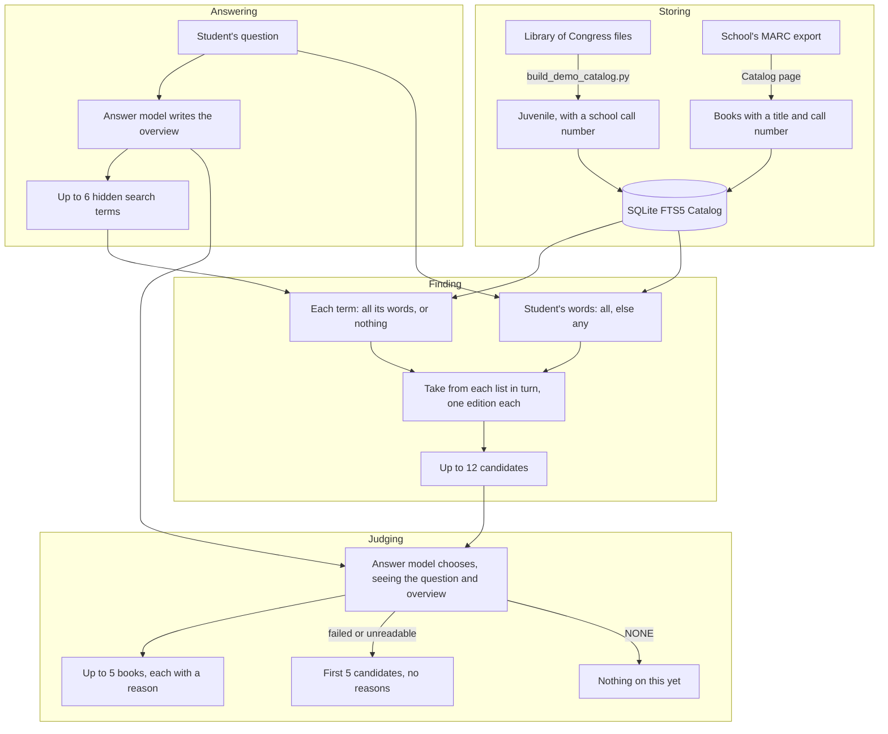

# How a Student's books are found

How the assistant stores books, finds candidates, chooses what to show, and what we know is
weak. Read this before changing search, and change it when search changes.

## Storing

Each book is one row in an FTS5 table holding title, author, subjects, summary, and call
number (`library_assistant/catalog/sqlite_backend.py`). The tokenizer is FTS5's default, with
no stemming, so "wolf" does not match "wolves".

- **Demo:** Library of Congress records kept by `is_shelf_ready` (`catalog/marc.py`). Call
  numbers are built from the record's Dewey field, and a real school's may differ.
- **A school:** its MARC export, loaded whole on the Catalog page
  (`catalog/school_import.py`), under its own call numbers.

## Finding

The model's terms come from the hidden `SEARCH:` line (`prompt.py`). It's told to start with
the subject, pair the subject with what the answer talks about, and add at most one broader
subject.

`search_each` (`catalog/__init__.py`) runs each term alone with `search_strict`, then the
Student's own words with `search`, and takes one book from each list in turn.

## Ranking

Inside one search, SQLite's BM25 ranks books, with these column weights:

| Title | Subjects | Author | Summary | Id, call number |
|---|---|---|---|---|
| 10 | 5 | 2 | 1 | 0 |

After that, order is only the turn-taking. BM25 scores from different terms are not compared.

## Judging

A second, short model call sees the question, up to 1,000 characters of the overview, and each
candidate's title, author, and up to 200 characters each of subjects and summary. It answers
with numbers and one line each, or `NONE`. It can only choose from the list, so it can't invent
a book. Its reason is the model's own and can be wrong.

There's no relevance score for a shown book. BM25 only orders candidates, and the model's choice
is a yes or no with an order.

## The numbers to tune

| Setting | Value | Where |
|---|---|---|
| Search terms | 6 | `MAX_SEARCH_TERMS`, `prompt.py` |
| Candidates | 12 | `BOOK_CANDIDATES`, `routers/session.py` |
| Books shown | 5 | `MAX_BOOKS`, `prompt.py` |
| Column weights | above | `_COLUMN_WEIGHTS`, `sqlite_backend.py` |
| Rows fetched per candidate | 4 | `_ROWS_PER_RECORD`, `sqlite_backend.py` |

## What we know is weak

- **Answers vary run to run.** The answer and choosing calls set no temperature or seed, so one
  question gives different overviews, terms, and books. Only Oversight sets temperature 0.
  Measuring a change needs both fixed.
- **Search depends on the overview.** Its terms come from the same reply, so a wrong overview
  aims the search at the wrong books.
- **Nothing measures quality yet.** Every change so far was judged on a handful of questions.
- **Reading level is ignored.** A picture book competes with a middle-school book.
- **No stemming, and no matching on meaning.**
- **Word matching favors what's in the record.** Many records have no summary, so the model
  judges those by title and subjects alone.
