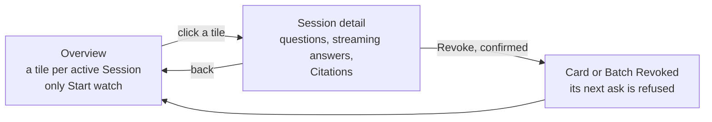
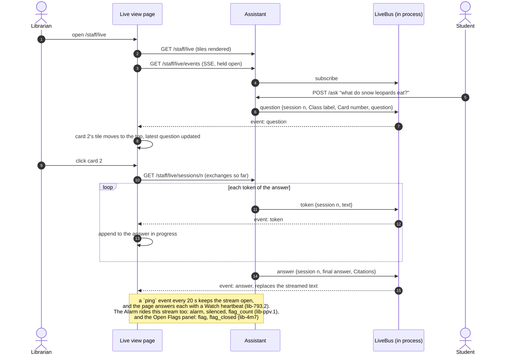
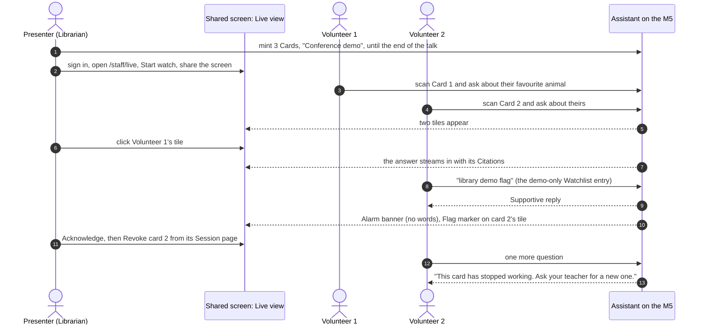

# Live view

The Librarian's running view of what Sessions are asking (`CONTEXT.md`), and the place
observation happens, which is why same-day retention costs nothing (ADR-0003). It has two
levels: an **overview** of every active Session, and a **Session detail** page you click
into to watch one conversation as it happens. Binding: ADR-0002 (no Card-to-Student link),
ADR-0007 (our own thin UI), ADR-0010 (Watch, Alarm), ADR-0003 addendum (`no-store`, no
copies).

Decided 2026-10-25 by the owner: the overview and click-through are the Live view for every
Install, not a demo mode. The words are shown. A Librarian locks their workstation when
they step away, as they would with any pupil record on screen.

## What each level shows

| | Overview `/staff/live` | Session detail `/staff/live/sessions/{n}` |
|---|---|---|
| Who | Librarian (and Stand-in, lib-793.1) | Same |
| One row per | Active Session, most recent activity first | Exchange, oldest first |
| Shows | Class label, Card number, time since last activity, message count, latest question (80 chars), Flag marker | Each question, its answer streaming in as it's written, Citations |
| Controls | **Start watch / End watch** only (ADR-0010): nothing that changes a Session, so it's safe to leave on screen or share | Revoke this Card, Revoke the Batch, each behind a confirm |
| Never shows | A name, a Token or hash, Roster data, a Flag's category or reason | The same |

`n` is the Session's row number in the database: opaque, and never the Session's hash.

## How it stays live

Everything runs in the one process (ADR-0008), so `/ask` hands each event straight to an
in-process bus, and every open Live view page holds one server-sent event stream. Nothing
polls the database, and token text never goes anywhere but the open stream and, at the end,
the transcript.

A high-severity Flag on a watching page raises the Alarm banner without any words
(ADR-0010), and the Session's tile gets a Flag marker by severity only. The words are one
click away, on the Session detail page or the Flag's own page.

Every open Flag, low-severity included, is also a row in the **Open Flags** panel at the
top of the overview and the Session detail (ADR-0010 amendment, lib-4m7): severity, Class
label, Card number, time, and source, high-severity first, each a link to the Flag. Rows
arrive and leave over the same stream (`flag`, `flag_closed`), and the tile marker follows
them, so nothing waits for a refresh. Like the tiles, a row never shows the category.

One exception to "never shows a Flag's category": the Alarm banner names it ("Alarm: high
self-harm (watchlist)"), as ADR-0010's "What it shows" says. The banner appears only for a
high-severity Flag and only until it is Acknowledged; Acknowledge before sharing the screen.

## The conference demo

Two volunteers chat on their phones while the presenter screen-shares the overview. The
demo uses the Live view exactly as a school would (lib-f24.63's runbook has the steps):

Two volunteers is about what the M5 serves comfortably (the owner's estimate).
lib-f24.74 and lib-f24.75 measure it, and if a supervised class needs more than ADR-0009
assumes, an ADR-0009 addendum records the real number.

## Beads

| Piece | Bead | Stage |
|---|---|---|
| Overview tiles | lib-f24.47 | local |
| Session detail | lib-f24.71 | local |
| Live updates (tiles, detail) over SSE | lib-f24.48 | frontier |
| Answers stream token by token | lib-f24.72 | frontier |
| Revoke from the Session detail | lib-f24.49 | local |
| Flag marker on tiles | lib-f24.73 | local |
| Open Flags panel, live tile markers | lib-4m7 | frontier |
| Conference runbook | lib-f24.63 | frontier |
| Capacity: probe, then measure on the M5 | lib-f24.74, lib-f24.75 | local, human |
