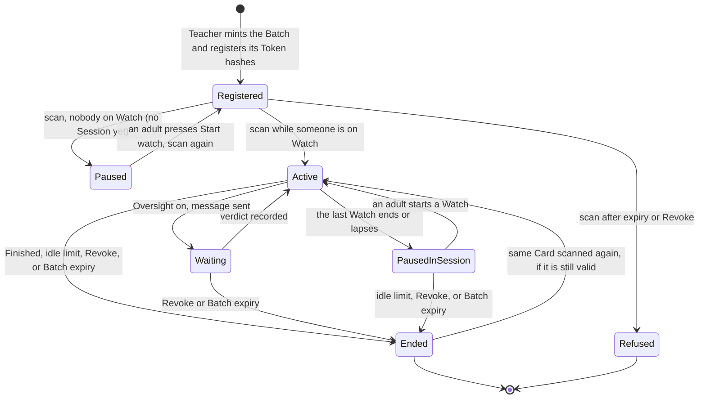
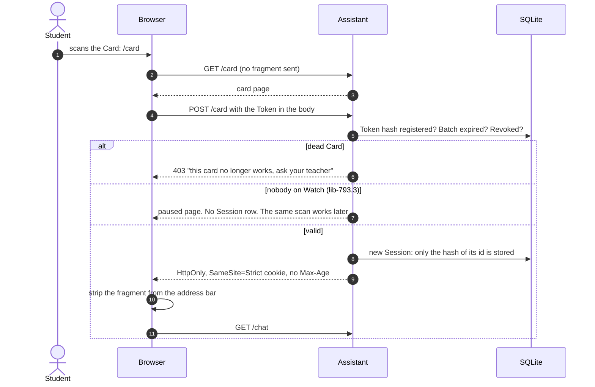
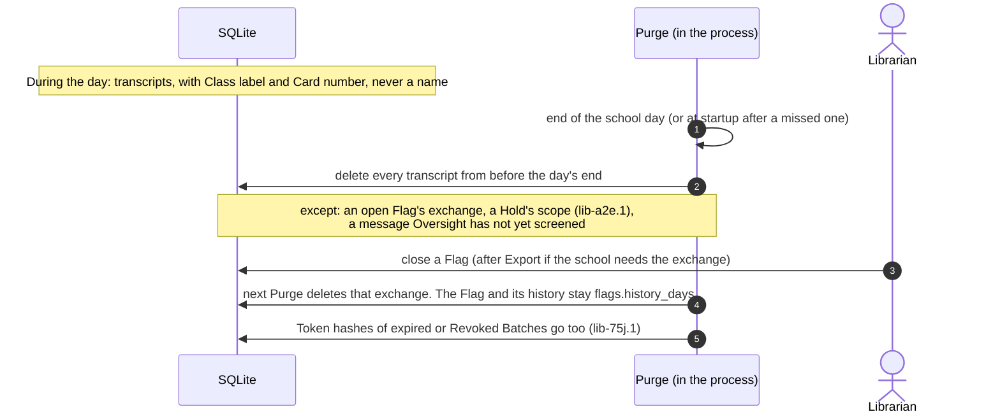

# Session lifecycle

How one Card's Session starts, what pauses it, what ends it, and what happens to its words
afterwards. Binding: ADR-0002 (minting and Registration), ADR-0003 and its addendum (Purge,
Tokens never in a URL), ADR-0010 (Watch, Cards last one school day).

## States

| State | What the Student sees | Built by | On main? |
|---|---|---|---|
| Refused | "this card no longer works, ask your teacher" | lib-f24.1 | yes |
| Paused (at sign-in) | "The Library Assistant is taking a break until the librarian is ready." The Card stays valid | lib-793.3 | no |
| Active | The chat page | lib-f24.1, lib-f24.4 | yes |
| Waiting | "One moment..." with their text kept | lib-f24.54, lib-f24.56 | no |
| PausedInSession | The same break message, input disabled, unsent text kept | lib-793.3 | no |
| Ended | Finished: "You can close this page". Idle: "scan your card again". Revoke or expiry: the Card refusal | lib-f24.1, lib-f24.61 | Finished, Revoke, expiry: yes. Idle: no |

**A Flag is not a state.** Neither a Watchlist nor an Oversight Flag moves a Session
anywhere. An adult who wants a Student to stop can Revoke that Card from the Live view
(lib-f24.49). The other Cards in the Batch keep working.

## Sign-in

The Token never reaches the server in a URL (ADR-0003 addendum). The QR code carries it in
the fragment, which browsers don't send, and the page posts it once.

Every later request rechecks the Card row. So a Revoke, or the Batch reaching its expiry,
ends the Session at the next request. No Session outlives the school day, because
Registration refuses an expiry past it (lib-f24.44).

## What ends a Session

| Cause | Who | Effect on the Card | Built by |
|---|---|---|---|
| Finished button | Student | None: the Card can start a new Session | lib-f24.1 (on main) |
| Idle past the limit (default 20 min, 0 = none) | The Librarian sets the limit | None: scan again | lib-f24.60, lib-f24.61 |
| Revoke this Card | Librarian, from the Session detail page in the Live view | Dead for good | lib-f24.49 (the registration-key route is on main) |
| Revoke the Batch | Librarian, from the Session detail page in the Live view | Every Card in the Batch dead | lib-f24.49 |
| Batch expiry | Set at minting, no later than the end of the school day | Dead | lib-f24.1 (on main), lib-f24.44 |

## What happens to the words afterwards

| Step | Built by | On main? |
|---|---|---|
| Daily Purge, the startup run, open-Flag exception | lib-f24.40 to lib-f24.43 | no |
| Unscreened exception | lib-f24.58 | no |
| Holds | lib-a2e.1 | no |
| Flag history, Export, close | lib-ce5.1 | no |
| Token hashes and Flag histories swept | lib-75j.1 | no |
| No copies in logs, WAL, or backups | lib-75j.2 | no |
