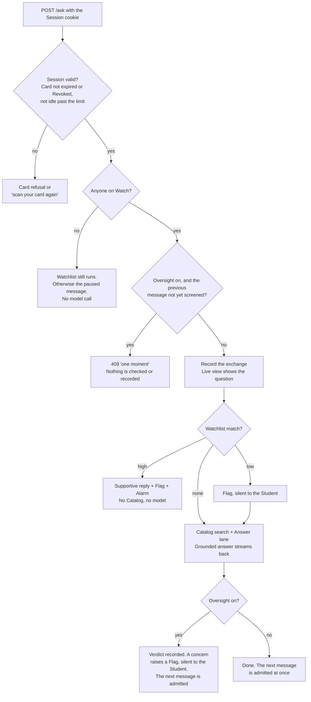
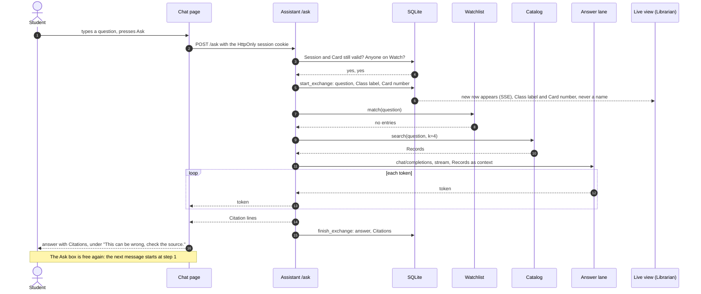
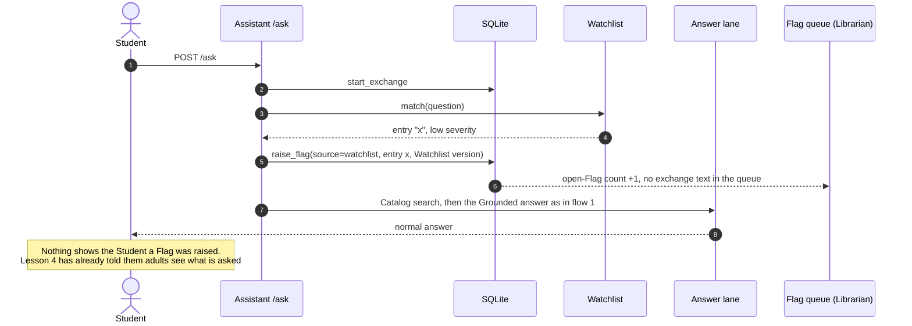
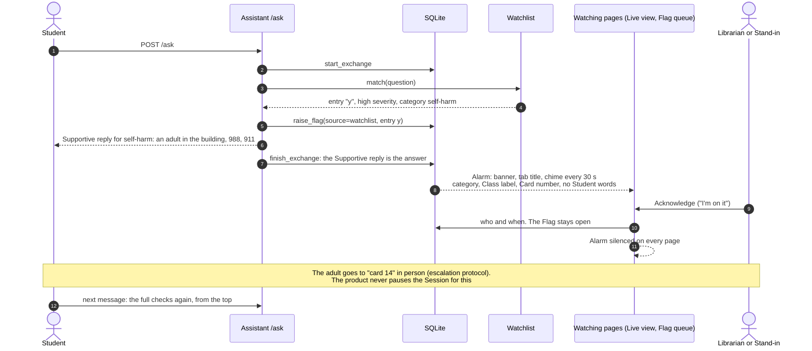
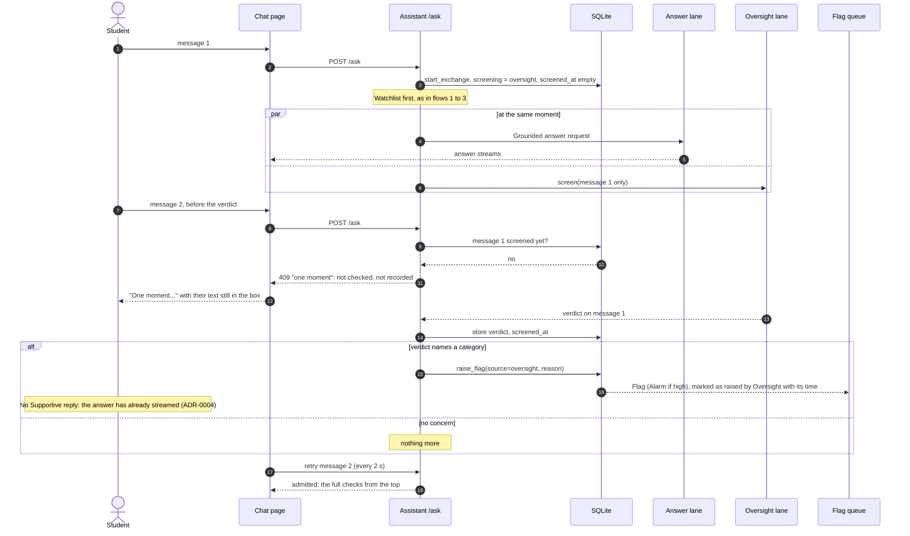
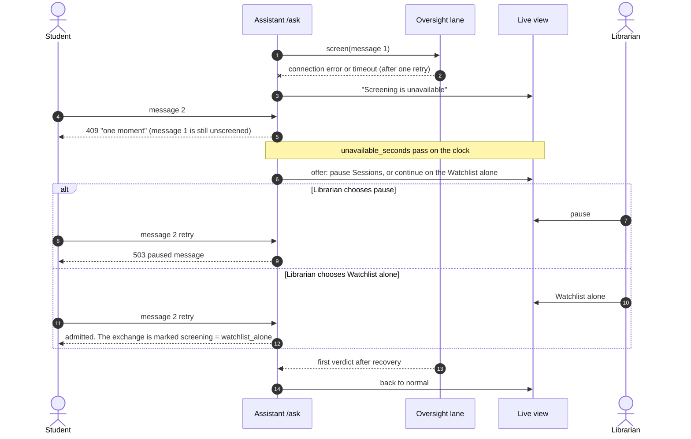
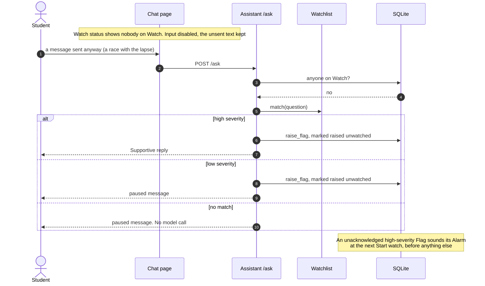

# Student message flow

What happens to one Student message, from the chat box to the reply, the Live view, and the
Flag queue. Binding: ADR-0003 (Purge), ADR-0004 (Watchlist and Oversight), ADR-0006
(intranet only), ADR-0010 (Watch and Alarm), ADR-0011 (Supportive reply).

**Short answer to "can they keep prompting?"** Yes, in every case except three: nobody is on
Watch, Oversight hasn't yet returned its verdict on their previous message, or the Session
has ended. A Flag never stops a Session. Not even a high-severity one does that: ADR-0010
rejected pausing on an Alarm because it would punish the other Students and tell the room
something happened. An adult acts in person instead. The [table below](#can-a-student-keep-prompting)
gives every case.

## The checks, in order

Every message passes the same gates, in this order. A gate that refuses stops the message
there.

| Gate | Built by | On main? |
|---|---|---|
| Session cookie, Card expiry and Revoke | lib-f24.1, lib-75j.3 | yes |
| Idle limit | lib-f24.60, lib-f24.61 | no |
| Watch gate | lib-793.2, lib-793.3 | no |
| "One moment" while screening | lib-f24.54, lib-f24.56 | no |
| Exchange recorded on arrival | lib-f24.34 | no: today it is recorded after the answer |
| Watchlist, Flag, Supportive reply | lib-f24.35, lib-f24.36, lib-f24.37 | no |
| Catalog search and Grounded answer | lib-f24.3, lib-f24.4 | yes |
| Oversight verdict | lib-f24.52 to lib-f24.55 | no |
| Alarm | lib-ppv.1 | no |

## 1. No match: the common case

Most messages on most Installs. The Watchlist finds nothing, the answer streams, and the
Student can ask again at once.

## 2. Low-severity match

The Student sees nothing different. The Flag waits in the Flag queue for an adult. There is
no Alarm and no sound: the queue's count goes up (ADR-0010, "What raises one").

## 3. High-severity match

The Supportive reply replaces the answer: no Catalog search and no model call. Every
matching entry raises its own Flag, and the Student gets one reply chosen by ADR-0011's
order: self-harm, threats of violence, abuse, bullying. An Alarm sounds on every watching
page. **The Session carries on.** The Student can keep typing, and each message goes through
the same checks again.

## 4. With Oversight configured

Oversight screens each message beside its answer, on its own Lane (ADR-0004, "Screening is
real time and ordered per Session"). The Student gets the answer as fast as without
Oversight. What changes is the **next** message: it is not admitted until the verdict on
this one is recorded. Another Session never waits on this one.

The gap is usually a second or two, because screening one short message is fast next to
writing an answer. An Oversight call is never cancelled to make room for another Student.

## 5. Oversight configured but down

The next message waits instead of going unscreened. After `oversight.unavailable_seconds`
(default 30), the Librarian decides.

Message 1 stays unscreened until Oversight recovers. The Purge keeps it until then
(lib-f24.58).

## 6. Nobody on Watch

Students chat only while an adult is on Watch (ADR-0010). The chat page follows the Watch
state and disables the box. A message that races the lapse still gets the Watchlist and,
for a high-severity match, the Supportive reply. The safety net never switches off.

## Can a Student keep prompting?

| Situation | Next message | Why |
|---|---|---|
| No match | Admitted at once (once the verdict lands, with Oversight on) | Flow 1 |
| Low-severity Watchlist Flag | Admitted. The Student never learns of the Flag | Flow 2 |
| High-severity Watchlist Flag | Admitted. Every message is checked again | Flow 3. ADR-0010 rejected pausing on an Alarm |
| Oversight Flag | Admitted once the verdict is recorded, which is the moment the Flag is raised | Flow 4 |
| Oversight still screening the previous message | "One moment" until the verdict | Flow 4, ADR-0004 |
| Oversight down | Waits. After 30 s the Librarian chooses pause or Watchlist alone | Flow 5 |
| Nobody on Watch | Paused message. Watchlist and Supportive reply still run | Flow 6, ADR-0010 |
| Card Revoked, or Batch expired (end of the school day at the latest) | Refused: "this card no longer works, ask your teacher" | [Session lifecycle](session-lifecycle.md) |
| Idle past the Librarian's limit (default 20 min) | Refused: "scan your card again". The Card still works | [Session lifecycle](session-lifecycle.md) |
| Student pressed Finished | That device's Session ends. The Card still works | [Session lifecycle](session-lifecycle.md) |

## Open questions found while drafting

Each one needs a decision before the bead that meets it is built.

1. **Two messages at once without Oversight.** Today the chat page doesn't disable Ask while
   an answer streams, and `/ask` will start a second answer for the same Session in
   parallel. With Oversight off, nothing in the design orders a Session's messages. Should a
   Session have at most one message in flight whether or not Oversight is on? That would
   also stop one Card from hogging the box ADR-0009 sizes for a class.
2. **The same high-severity phrase, repeated.** A Student who types it three times raises
   three Flags and, under lib-ppv.1 as written, three Alarms. Does an open, unacknowledged
   Alarm for the same Card absorb the next one, or does each Flag chime?
3. **Oversight on a message that already got a Supportive reply.** lib-f24.54 still screens
   it, so ordering stays uniform, which may raise a second Flag on the same exchange. Keep
   that, or skip Oversight when the Watchlist already matched high?
4. **What "one moment" looks like when it lasts.** With Oversight down, a Student can sit at
   "one moment" for up to `unavailable_seconds` before the Librarian is even asked. Should the
   page say more after some seconds, or is the paused message the only other state?
