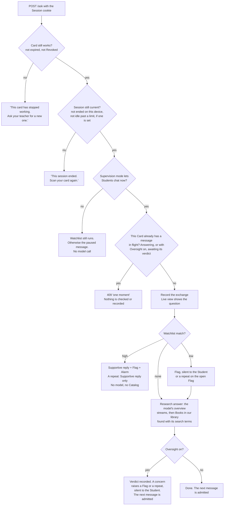
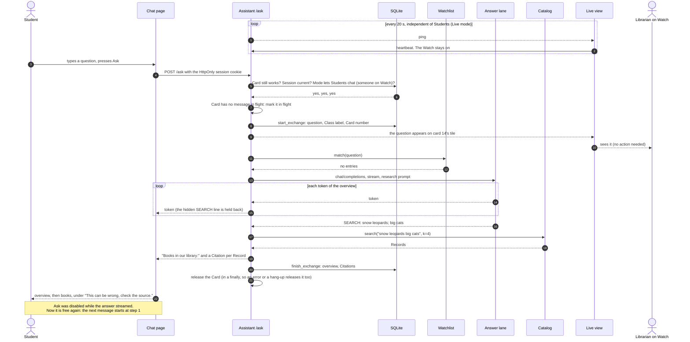
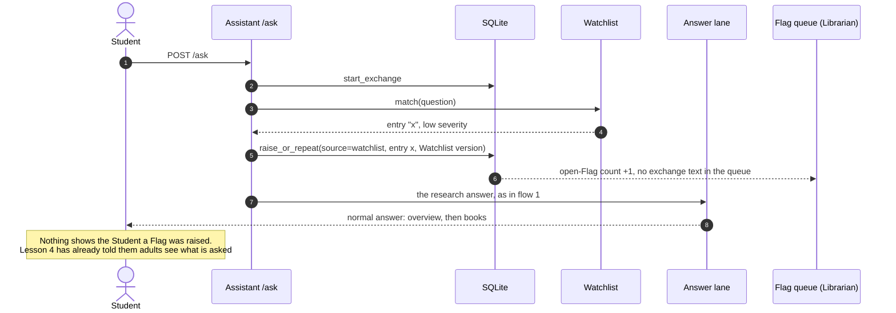
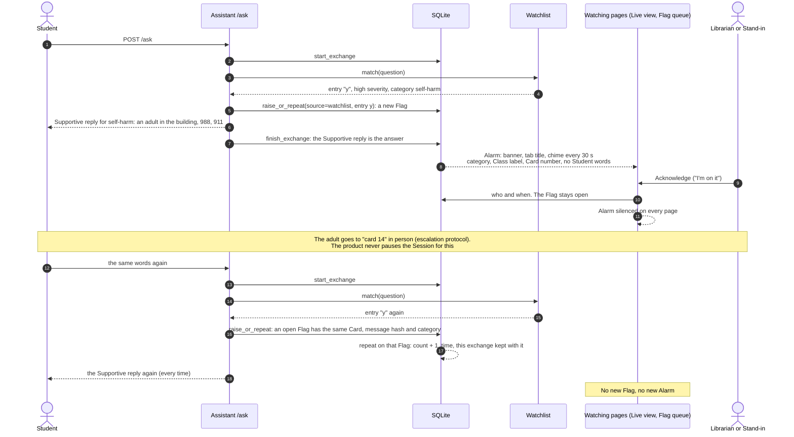
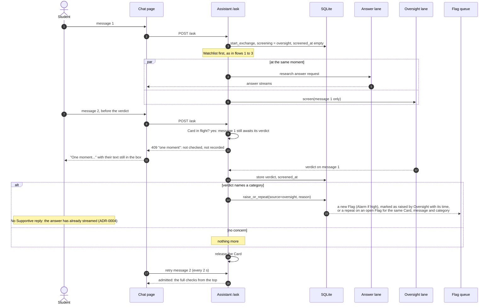
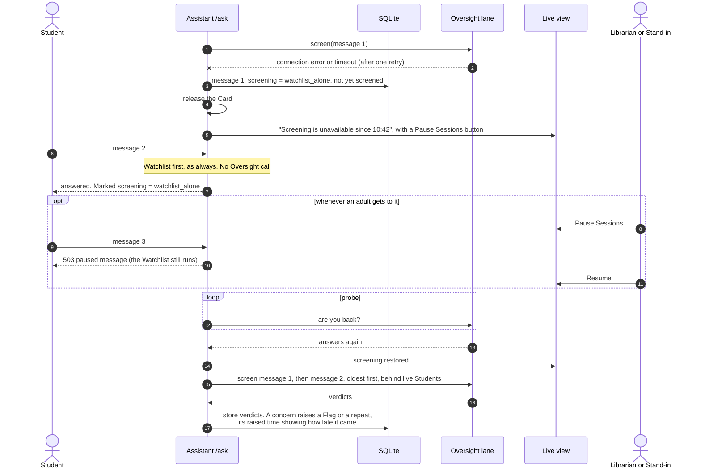
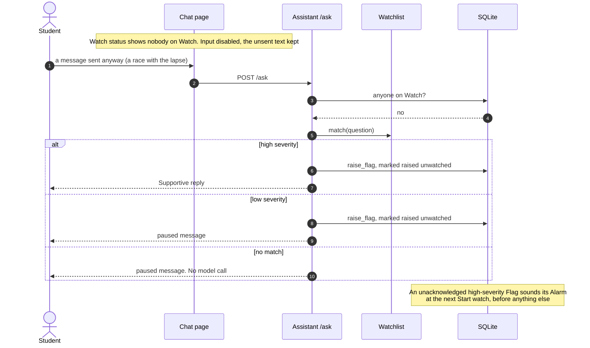

# Student message flow

What happens to one Student message, from the chat box to the reply, the Live view, and the
Flag queue. Binding: ADR-0003 (Purge), ADR-0004 (Watchlist and Oversight), ADR-0006
(intranet only), ADR-0010 (Watch, Alarm, and its supervision-mode amendment), ADR-0011
(Supportive reply).

**Short answer to "can they keep prompting?"** Yes, one message at a time, in every case except
three:
- the supervision mode holds Students: in Live mode nobody is on Watch, or in periodic mode
  a review is overdue past the pause the Librarian set;
- their previous message is still in flight: being answered, or, with Oversight on,
  awaiting its verdict;
- the Session has ended.

A Card has at most one message in flight, so one Student can't crowd out the rest of the
class (lib-f24.65). A Flag never stops a Session, not even a high-severity one: ADR-0010
rejected pausing on an Alarm because it would punish the other Students and tell the room
something happened. An adult acts in person instead. The
[table below](#can-a-student-keep-prompting) gives every case.

## The checks, in order

Every message passes the same gates, in this order. A gate that refuses stops the message
there.

"Supervision mode lets Students chat now?" depends on the mode the Librarian set
([Watch and supervision](watch.md)):
- **Live** (the default): someone is on Watch.
- **Periodic:** always, unless the Flag queue review is overdue by more than the pause the
  Librarian set (0 = never pause).
- **Off:** always.

| Gate | Built by | On main? |
|---|---|---|
| Card expiry and Revoke, Session cookie | lib-f24.1, lib-75j.3 | yes |
| Clearer refusal text, End session, a new sign-in ends the device's previous Session | lib-f24.81, lib-f24.82, lib-f24.83 | no |
| Idle limit (default off) | lib-f24.60, lib-f24.61 | no |
| Supervision mode and Watch gate | lib-f24.78, lib-793.2, lib-793.3 | no |
| One message in flight per Card ("one moment") | lib-f24.68, lib-f24.56; lib-f24.54 extends it to the verdict | no: today a Student can send several at once |
| Exchange recorded on arrival | lib-f24.34 | yes |
| Watchlist, Flag, Supportive reply | lib-f24.35, lib-f24.36, lib-f24.37 | no |
| Repeat on an open Flag | lib-f24.69 | no |
| Research answer (overview, then books) | lib-f24.59 | no: today the Catalog is searched first and the model answers only from it |
| Oversight verdict | lib-f24.52 to lib-f24.55 | no |
| Alarm | lib-ppv.1 | no |

## 1. No match: the common case

Most messages on most Installs. The Watchlist finds nothing. The model writes an overview
from what it knows, and the Catalog then supplies books to check it against. The Student can
ask again as soon as the answer ends.

The watcher is in this diagram on purpose, though they do nothing for this message. In Live
mode the gate reads a Watch that the watcher's page keeps alive on its own clock (heartbeat
every 20 s), separate from Student traffic. The watcher only meets a message when it shows
up on their Live view.

## 2. Low-severity match

The Student sees nothing different. The Flag waits in the Flag queue for an adult. There is
no Alarm and no sound: the queue's count goes up (ADR-0010, "What raises one").

## 3. High-severity match

The Supportive reply replaces the answer: no Catalog search and no model call. Every
matching entry raises its own Flag, and the Student gets one reply chosen by ADR-0011's
order: self-harm, threats of violence, abuse, bullying. An Alarm sounds on every watching
page. **The Session carries on.** The Student can keep typing, and each message goes through
the same checks again. The same words from the same Card, while their Flag is open, are
marked a **repeat** on that Flag rather than raising a new Flag and Alarm (lib-f24.66).

## 4. With Oversight configured

Oversight screens each message beside its answer, on its own Lane (ADR-0004, "Screening is
real time and ordered per Session"). The Student gets the answer as fast as without
Oversight. What changes is the **next** message: it is not admitted until the verdict on
this one is recorded. Another Session never waits on this one.

The gap is usually a second or two, because screening one short message is fast next to
writing an answer. An Oversight call is never cancelled to make room for another Student.

## 5. Oversight configured but down

The class carries on with the Watchlist alone. The adults are told and act when they can,
because human attention is asynchronous (ADR-0004 addendum, "Oversight down does not hold
Students"). Screening catches up when Oversight is back.

Until they're screened, the exchanges admitted while Oversight was down survive the Purge
(lib-f24.58).

## 6. Supervision holds Students

In Live mode (the default) Students chat only while an adult is on Watch (ADR-0010). In
periodic mode they are held only when the Flag queue review is overdue past the pause the
Librarian set. In Off mode they are never held ([Watch and supervision](watch.md)). The
diagram shows Live mode. The chat page follows the gate and disables the box. A message that races the lapse still gets the Watchlist and,
for a high-severity match, the Supportive reply. The safety net never switches off.

## Can a Student keep prompting?

| Situation | Next message | Why |
|---|---|---|
| No match | Admitted once the answer ends (once the verdict lands, with Oversight on) | Flow 1 |
| Previous message still being answered | "One moment" until it ends. The same Card on a second device waits too | Flow 1, lib-f24.65 |
| Low-severity Watchlist Flag | Admitted. The Student never learns of the Flag | Flow 2 |
| High-severity Watchlist Flag | Admitted. Every message is checked again | Flow 3. ADR-0010 rejected pausing on an Alarm |
| The same words again, while their Flag is open | Admitted. Marked a repeat on that Flag, no new Alarm. A Supportive reply every time | Flow 3, lib-f24.66 |
| Oversight Flag | Admitted once the verdict is recorded, which is the moment the Flag is raised | Flow 4 |
| Oversight still screening the previous message | "One moment" until the verdict | Flow 4, ADR-0004 |
| Oversight down | Admitted at once on the Watchlist alone (unless the Librarian set oversight_down = pause). An adult can pause Sessions when they choose. Screening catches up later | Flow 5, ADR-0004 addendum |
| Live mode and nobody on Watch, or periodic mode with the review overdue past the pause | Paused message. Watchlist and Supportive reply still run | Flow 6, ADR-0010 and its amendment |
| Off mode, or periodic mode within the review interval | Admitted. Nothing waits on an adult; the Flag queue is reviewed on the school's schedule | [Watch and supervision](watch.md) |
| Card Revoked, or Batch expired (end of the school day at the latest) | Refused: "This card has stopped working. Ask your teacher for a new one." Same words for both, so a Revoke is never announced | [Session lifecycle](session-lifecycle.md) |
| Idle past a limit, if the Librarian set one (default none: Students use their own Chromebooks) | Refused: "This session ended. Scan your card again." The Card still works | [Session lifecycle](session-lifecycle.md) |
| Student pressed End session | That device's Session ends. The Card still works | [Session lifecycle](session-lifecycle.md) |
| Another Card signs in on the same device (a shared library computer) | The device's previous Session ends at once. Its Card still works on its own device | [Session lifecycle](session-lifecycle.md), lib-f24.82 |

## Questions found while drafting

### Decided 2026-10-25

1. **One message in flight per Card** (lib-f24.65), so that one Student can't crowd out the
   others. This holds whether or not Oversight is on. It's keyed on the Card rather than the
   Session, so two devices don't get around it. A second message gets "one moment", unchecked
   and unrecorded. Built by lib-f24.68 and lib-f24.56; lib-f24.54 extends it until the verdict.
2. **A repeat, not a new Flag** (lib-f24.66). The same Card (Class label, Card number, Batch
   expiry) and the same normalized message, while a Flag in that category is open, count as a
   repeat on that Flag: a count, a time, and the exchange kept with it. No new Alarm. The
   message hash is cleared when the Flag closes, so nothing derived from the words outlives
   the exchange. Built by lib-f24.69.
3. **Supportive-reply messages are still screened** (lib-f24.67): they need human attention
   too. An Oversight verdict in the same category as the open Watchlist Flag is a repeat on it.
4. **Oversight down does not hold Students** (lib-f24.70): human attention is asynchronous.
   The class carries on with the Watchlist alone, the Live view tells the adults, who can
   pause whenever they choose, and screening catches up when Oversight returns. Recorded as
   an ADR-0004 addendum. Built by lib-f24.55.
5. **A research assistant, two hops** (lib-f24.27). Almost any question is fair, math
   included. The model writes a short overview from what it knows, and the Catalog then
   lists books found with the model's search terms, so no book is ever invented. The banner
   "This can be wrong, check the source." covers the overview, and the books are how you
   check. Built by lib-f24.59.
6. **Supervision mode** (lib-f24.77): Live (the default), periodic review, or off, set by
   the Librarian, with every change recorded. The Watchlist, the Supportive reply, and Flags
   never switch off. Recorded as an ADR-0010 amendment; see [Watch and supervision](watch.md).
7. **Students use their own Chromebooks** (lib-f24.77 notes). No idle limit by default. A
   shared library computer is covered by End session and by a new sign-in ending the
   device's previous Session (lib-f24.82). The dead-Card message tells the Student to ask for
   a new card, with the same words for expired and Revoked (lib-f24.81).
