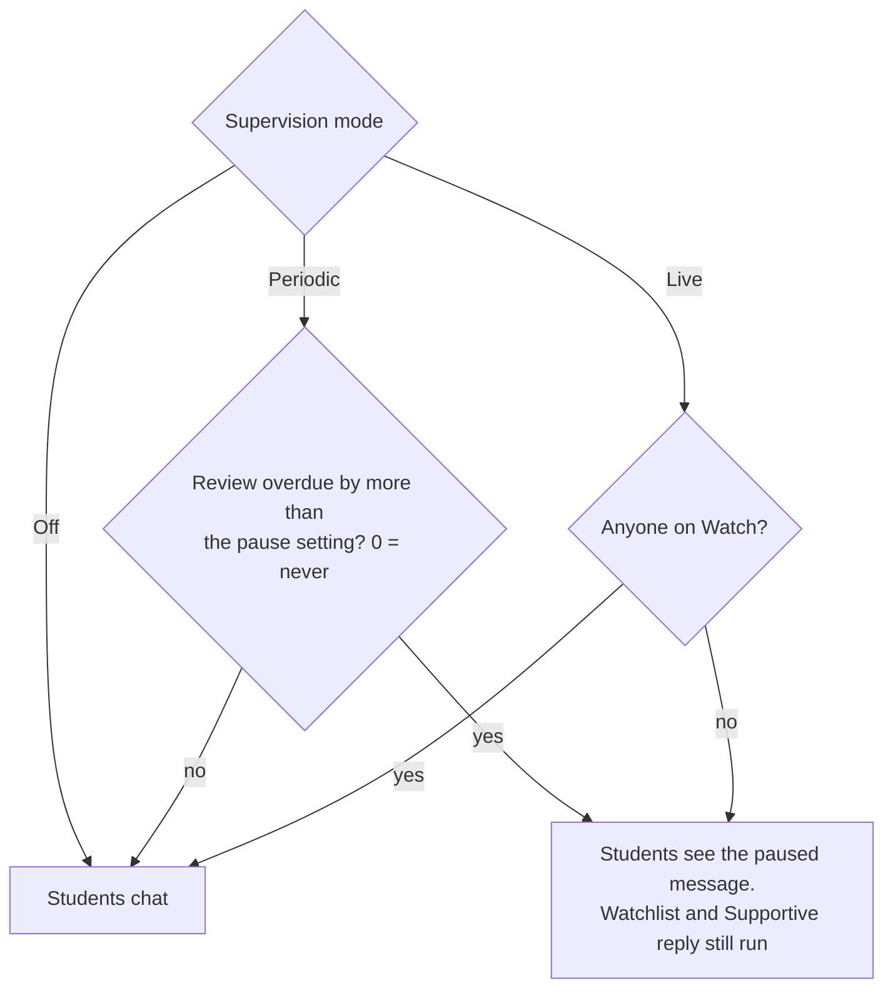
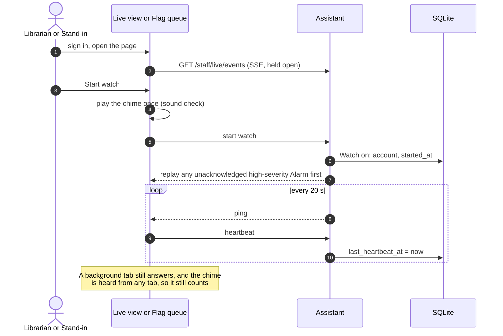
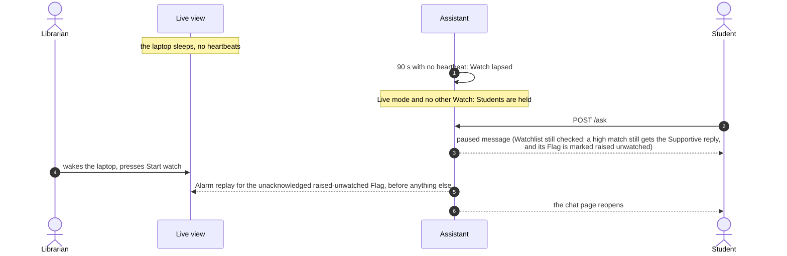
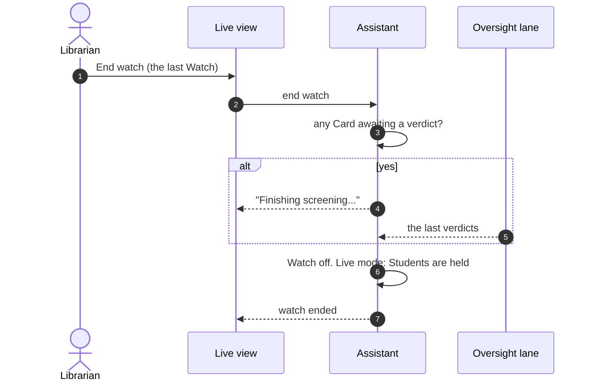
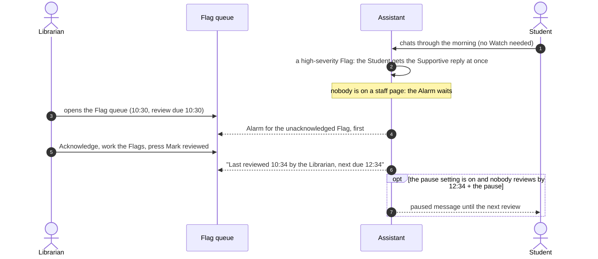

# Watch and supervision

How the adults' presence is known, and what it does to Students. Binding: ADR-0010 and its
"supervision mode" amendment, ADR-0004 (the Watchlist never switches off).

A **Watch** is an adult saying "I'm watching" on purpose, with the server checking they're
still there. The **supervision mode** is the Librarian's setting for how much that matters:

| Mode | Students can chat | Adults |
|---|---|---|
| **Live** (default) | only while at least one Watch is on | stay on the Live view or Flag queue |
| **Periodic review** | any time in the school day; optionally paused when a review is overdue by more than a set time (default: never) | review the Flag queue every `review_every_minutes` (default 120) and press Mark reviewed |
| **Off** | any time in the school day | the school's own policy |

The Watchlist, the Supportive reply, and Flags run in every mode. In every mode, an
unacknowledged high-severity Alarm sounds on the next staff page anyone opens.

## Who can watch

The Librarian, or a staff account the Librarian has made a Stand-in. A Counselor alone can't:
they see only Escalated Flags, so they'd miss a new high-severity one. One Watch covers the
whole Install, since there's one supervised class at a time (ADR-0009). Several adults can be
on Watch at once, and Students carry on while any one of them is.

## Start watch and the heartbeat

Opening the page isn't enough: Start watch is a button. The press is the adult saying so on
purpose, and it's the user gesture browsers require before a page may play sound, so the
button plays the chime once as a sound check.

## Lapse, and coming back

The Watch lapses when no heartbeat has arrived for `watch_grace_seconds` (default 90). A
dropped stream doesn't end it at once, so a reconnect doesn't pause the class. A laptop that
sleeps stops answering, and its Watch lapses. That's intended: the Students' paused page is
how the adult finds out.

## End watch

End watch, signing out, and the staff session expiring all end a Watch. If it's the last
Watch, an on-purpose end waits for any message whose Oversight screen is still in flight, so
no message is left unscreened with nobody present (ADR-0010 rule 3). A lapse can't wait, so a
Flag that lands after it is marked raised unwatched and replays at the next Start watch.

## Periodic review

In periodic mode nobody holds a heartbeat. The Flag queue shows when it was last reviewed and
when the next review is due, and an adult presses Mark reviewed after working through it.

The cost of a long interval is the time a disclosure can sit unseen. The Student always gets
the Supportive reply at once; the adults learn of it at the next review. The escalation
protocol template says who reviews and how often (lib-f24.80).

## Settings

All on the Librarian's settings page, each change recorded with who and when (lib-f24.78):

| Setting | Default |
|---|---|
| Supervision mode | Live |
| Review every (periodic) | 120 min |
| Pause Students when a review is overdue by (periodic) | never |
| Heartbeat grace | 90 s |
| Alarm chime / repeat | on / every 30 s |
| When Oversight is down | carry on with the Watchlist alone |
| Session idle limit | none (Students use their own Chromebooks) |

## Beads

| Piece | Bead |
|---|---|
| Settings and the change log | lib-f24.60, lib-f24.78 |
| Watch state, heartbeat, grace | lib-793.2 |
| The gate on sign-in and asks, by mode | lib-793.3 |
| Stand-in role | lib-793.1 |
| Mark reviewed, last and next review | lib-f24.79 |
| Alarm, chime, replay | lib-ppv.1 |
| Escalation protocol per mode | lib-f24.80 |
