<!-- _class: title dark -->
<!-- _paginate: false -->
<!-- _footer: '' -->



# Bring Nix to school

## A school library's AI, shipped as one Flox environment and two agent-stacks model packages

<div class="meta">Isaac Karrer · Planet Nix 2027<br />github.com/imkarrer/library-ai-lab<br />github.com/agent-stacks</div>

<!--
The library project is a personal project, not a product.

This deck describes agent-stacks as it should be by April 2027: model packages that any
process manager can serve (agent-stacks-spec issue #6, Proposal 0002 in PR #7). Notes marked
[APRIL] name what has to have landed for a slide to be true. Before the talk, check each
one; where it hasn't landed, change the slide to say "planned".
-->

---

## Others brought Nix to school first

<div class="cards">
<div class="card-panel">
<h3>Labs</h3>
<p>Marc Schmitt, NixCon 2020: "Bringing NixOS to my school". EPITA's labs are about 1,000
machines on 6 campuses, network-booted from one repo.</p>
</div>
<div class="card-panel">
<h3>Exams</h3>
<p>Ryan Lahfa and Yvan Sraka, NixCon 2020: a DevOps exam on NixOS, with a bastion host
and a VM for each of 70 students.</p>
</div>
<div class="card-panel">
<h3>Laptops</h3>
<p>Mike Kelly's Nixbook, SCALE 22x and SeaGL 2025: NixOS that updates itself, for old
laptops and Chromebooks.</p>
</div>
</div>

<div class="box">

Labs, exams and laptops have been done. This talk adds **a service in the building**,
which needs nothing installed on a student's device.

</div>

<p class="muted">av.tib.eu/media/50711 · av.tib.eu/media/50689 · github.com/epita/nixpie ·
github.com/mkellyxp/nixbook</p>

<!--
The ~1,000 figure is the nixpie README; the 2020 talk said "more than 800". The 70-student
figure is from the exam talk's abstract [VERIFY]. Don't imply EPITA or Nixbook use Flox.
-->

---

<!-- _class: lead dark -->
<!-- _paginate: false -->
<!-- _footer: '' -->

# A service on the shelf

<p class="lede">School Chromebooks stay exactly as IT set them up. A service on the school
network needs only their browsers, so Nix lives on one Mac on the library shelf.</p>

<!--
Why not the Chromebooks themselves: on managed devices Google blocks Linux by default
("Linux virtual machines" policy, support.google.com/chrome/a/answer/2657289), and replacing
ChromeOS costs the school Google Admin, its content filter and the state test browsers. If
asked, that's the "what's next" slide.
-->

---

## Why a library, and why Wisconsin

<div class="cards">
<div class="card-panel">
<h3>It started at home</h3>
<p>My wife is a middle school librarian in Wisconsin. I'm building this for her library
first, and for the way she already teaches research.</p>
</div>
<div class="card-panel">
<h3>Libraries teach checking</h3>
<p>A librarian, a catalog of real sources, and an adult whose job is teaching students to
check what they read. That's where an AI for kids belongs.</p>
</div>
<div class="card-panel">
<h3>Wisconsin has the money</h3>
<p>The Common School Fund, a land-grant endowment in the state constitution, made a record
$73.5M distribution to school libraries: books, software, and computers.</p>
</div>
</div>

<div class="box">

The catch: the library must **house the computer** (Wis. Stat. 43.70(3)). So the whole
product is one Mac on a shelf, never a server in the district datacenter.

</div>

<!--
Wisconsin is unusual: about 35 states give school libraries no direct aid. Texas's Permanent
School Fund pays for technology and instructional materials; New York pays $6.25 a pupil for
library materials. Wisconsin is the only one I found where library money buys the computer.
Eligibility is each district's call with DPI's School Library Education Consultant; we
designed to the statute, we don't certify it.
-->

---

## The problem is not the model

- Students already use chatbots, **under accounts with their names on them**.
- **No adult in the building** sees a worrying question.
- Schools that want something better can't run a cluster, hire an ML engineer, or
  **send pupil records to a vendor**.

<div class="box">

**We build for one Mac Studio on a library shelf.** We write for Apple silicon only: its
unified memory runs a real model on a quiet box with no GPU card, no rack, and no IT.

</div>

The person who installs it is the **school librarian**. They will never type `nix` and
won't call IT, so whatever we ship has to keep running with nobody who built it in the
room.

---

## What it does

<div class="steps">
<div class="card-panel"><strong>A Card</strong><p>A Student scans a QR code with a number on
it. The assistant never learns a name.</p></div>
<div class="card-panel"><strong>An answer</strong><p>An overview from the answer model, then
real books from the school's own catalog.</p></div>
<div class="card-panel"><strong>Oversight</strong><p>A second, small model screens every
message and raises a Flag for an adult.</p></div>
<div class="card-panel"><strong>Purge</strong><p>The assistant deletes every conversation at
the end of the school day.</p></div>
</div>

<p class="muted">The privacy design is the product. Every PR has to keep these promises.</p>

---

## Three constraints that are really packaging problems

| Promise | What it means for the build |
|---|---|
| Stays in the building | **Offline after one setup.** It fetches once, then never again, with two planned exceptions. |
| Gone every day | **No prompt logs anywhere**, including inside the model server. |
| One thing to keep running | **One environment** with its services, not a stack of installers. |

<div class="box">

**The two exceptions:** product updates and HTTPS certificate renewal (Let's Encrypt). Both
use one short outbound window: the Mac's firewall opens it roughly monthly, to named hosts
only, and the assistant pauses Students. The app's internet self-check treats that window,
and only it, as expected.

</div>

<p class="muted">"Offline", "no logs" and "one thing" are properties of the closure, not of the
Python.</p>

---

<!-- _class: tight -->

## The whole Install

```toml
[install]
app.pkg-path          = "library-ai-lab/library-assistant"
answer-model.pkg-path = "agent-stacks/agent-model-gpt-oss-20b"
screen-model.pkg-path = "agent-stacks/agent-model-qwen3.5-4b"

[services.answer]
command = '''exec "$FLOX_ENV"/share/agent-models/gpt-oss-20b/bin/serve \
  --listen 127.0.0.1:11436 --protocol openai-chat-completions'''

[services.screen]
command = '''exec "$FLOX_ENV"/share/agent-models/qwen3.5-4b/bin/serve \
  --listen 127.0.0.1:11435 --protocol openai-chat-completions'''

[services.assistant]
command = 'exec library-assistant'
```

<p class="muted">Abridged. Three packages and three services, all in one environment.</p>

<!--
[APRIL] Assumes model packages are published under these names and can be installed outside
a stack. The names are illustrative until they exist. Today ./stack runs Ollama itself, with
models from `ollama pull`. The app's package exists today (flox build library-assistant, next
slide); publishing it under this name hasn't happened yet.
-->

---

## The app is a package too

- **Its libraries come from the Flox catalog,** in the same lock as Python: no PyPI, no venv.
  The tests run on what ships.
- **`flox build` makes the package.** The gate starts it with an empty environment on every
  PR, so it can't lean on the developer's shell.
- **`runtime-packages` decides what ships:** the app's libraries, not pytest, ruff or the
  model servers.

<div class="box">

**One library wasn't in the catalog:** pymarc, which reads a school's catalog export. So I
wrote its Nix for nixpkgs, where it belongs. Until that lands, the project carries a copy;
then the project has no Nix at all.

</div>

<!--
This is "way 5" from the Flox offsite talk: a [build] on the catalog's libraries. Before it,
activation ran uv pip install from PyPI into a venv, so the Python dependencies sat outside the
lock and "store paths are the bill of materials" wasn't true.

It's also what makes the district slide work: an environment pulled from FloxHub has no
checkout of our source, so the app has to arrive as a package, the same way the models do.

If asked: Python 3.13, because the catalog's python312Packages trail PyPI. The package's closure
is 1.4 GiB, and 1.3 GiB of that is python3 itself on macOS, which keeps a reference to clang in
its static libpython. The app's own files are small. pymarc builds from its upstream tag with
all 174 of its tests passing on Python 3.11 to 3.14.
-->

---

## The models are agent-stacks packages

```text
share/agent-models/gpt-oss-20b/
├── bin/serve     starts the server on the address it's given, prints "ready"
├── bin/check     fails fast on a Mac without enough memory
├── bin/ollama    the server, pinned with the weights
├── blobs/        weights, template, licence: each pinned by digest
└── manifests/    which blobs make up the model
```

- **Pinned when the package builds.** Nothing downloads at activation, and a missing blob
  fails the build instead of fetching.
- **`serve` is a contract.** Any process manager can call it: here, two Flox services.
- **One server per model**, so screening never waits on answering.

<!--
[APRIL] The layout is Proposal 0002's (share/agent-models/<name>/, bin/serve, bin/check),
with room for an Ollama model's several files. Both models run on the Mac's GPU through
Metal, about 59 tokens/s for gpt-oss.

What the package hides, from our prototype (docs/research/models-in-the-closure.md): Ollama
needs an empty manifests-v2/ and OLLAMA_NOPRUNE=1 to serve from a read-only store, and a
plain fetcher holds the 13.8 GB file in memory at about 4.4x its size.
-->

---

## We are the harness

| | An agent client in a stack | The Library Assistant |
|---|---|---|
| Who uses it | One person at a terminal | A class of students in browsers |
| What starts the model | The stack launcher | A process manager, beside the app |
| How long it runs | Until the person is done | All school day |
| Which model | A default; the client picks | Fixed by role: one answers, one screens |

<div class="box">

agent-stacks gives us the **model package** and its **`serve` command**. We skip the part
that wires a model into a harness, because **the app is the harness**.

</div>

<!--
The app makes plain OpenAI-style chat completions calls, up to three per student message:
a screening call to qwen3.5:4b at the same moment as a streamed answer from gpt-oss:20b,
then a second answer-model call that picks books from the catalog. The app runs that loop
itself, with no tool calling: it pulls a SEARCH line out of the stream and queries the
catalog. Each model is configured as an address and a name, per role
(LIBRARY_ASSISTANT_OPENAI_ENDPOINT, LIBRARY_ASSISTANT_OVERSIGHT_ENDPOINT).

If the screening model is down, the app keeps answering and screens with the keyword
Watchlist until it's back. A launcher that refuses to start when a model is missing is the
wrong behaviour for this app; failing closed belongs at build time.

[APRIL] Assumes the spec says `serve` may be called by any process manager, not only the
stack launcher. That's the one thing to make sure Proposal 0002 doesn't rule out.
-->

---

## Policy you can grep for

```sh
# gpt-oss-20b/bin/serve, generated when the package builds
export OLLAMA_NO_CLOUD=1               # no call home at startup
export OLLAMA_MODELS="$here/.."        # read-only, in the store
export OLLAMA_HOST="$listen"           # 127.0.0.1 only
"$here/ollama" serve >&2 &             # then: wait for it, print "ready"
```

- A **privacy reviewer** reads the package and the manifest, not a wiki page.
- The **confidentiality scan** runs in the same gate as the tests
  (`flox activate -- bash scripts/check.sh`), locally and in CI.
- The demo, the dev box and CI **activate the same environment**.

<!--
[APRIL] Check the generated serve script really sets these, and that the Ollama version it
pins keeps no log of a prompt [VERIFY]. Without OLLAMA_NO_CLOUD, `ollama serve` calls
ollama.com at startup; we found that by reading what the package does once it was in the
manifest. That is the case for declared egress, on the "what's next" slide.

The same environment does three jobs. It is the Install. It is the gate: ruff, the
confidentiality scan, and ~980 tests, with a fake model and a fake catalog so UX work
doesn't wait on a GPU. And a second, small environment builds this deck and the librarian's
handout, kept apart so a school's Install never pulls in a browser.
-->

---

## The agent that builds it is an agent stack

```nix
# flake.nix at the repo root
agent = agent-pkgs.lib.${system}.mkAgentStack {
  name = "library-ai-lab";
  harness = agent-pkgs.packages.${system}.claude-code;
  plugins = [ bead-loop.packages.${system}.agent-plugin-bead-loop ];
};
```

- **`nix run`** at the repo root starts Claude Code with this repo's skills, the same
  everywhere.
- A stack is **an agent client, its plugins, and their runtimes**, built as one unit.
- The school's Install is a Flox environment. **The agent that writes it is a stack.**

<p class="muted">agent-stacks.org · github.com/agent-stacks/agent-pkgs</p>

<!--
Two closures, kept apart on purpose: the Install a librarian runs (.flox/) and the agent a
contributor runs (flake.nix). A school never gets Claude Code. The agent-stacks spec is at
github.com/agent-stacks/agent-stacks-spec (0.1.0 draft).
-->

---

## Offline is a supply-chain problem

- **One online moment**: activate the environment, models included, and build the catalog.
  After that, the Mac talks to the internet only in the update and renewal window.
- The **store paths are the bill of materials.** What ran in the demo is what runs in the
  school.
- Updates are a new generation, **not a person driving to the school**.

<p class="muted">At the venue there is no internet either: the demo runs on a travel router
and this laptop.</p>

<!--
The demo runs on an M5 Pro MacBook: the same Apple silicon and unified memory as the Studio
a school would buy, just less of it. The school's Studio gets the most memory the budget
allows; that's what decides which models it can run.
-->

---

## From one library to a district

<div class="steps">
<div class="card-panel"><strong>Prove it</strong><p>One Mac, one librarian, one school
year.</p></div>
<div class="card-panel"><strong>Publish it</strong><p>District IT pushes the environment to
its FloxHub organization.</p></div>
<div class="card-panel"><strong>Every library</strong><p>Each library's Mac pulls that one
environment, and upgrades with it.</p></div>
<div class="card-panel"><strong>Each school's own</strong><p>Timezone, end of day, counselor
and catalog stay in each Install's config.</p></div>
</div>

<div class="box">

The app is free for schools. **FloxHub is how a district ships it**, and everyone in district
IT who publishes, reviews or rolls it out is **a FloxHub seat**.

</div>

<!--
The pitch: get Nix into one library, and the district buys FloxHub seats to run it in all of
them. The Library Assistant's licence lets a school or district run it free, installed and
operated by its own employees (README, "License"), so FloxHub is what a district pays for, not
the app.

How it works: `flox publish` puts the app's package in the district's FloxHub catalog and
`flox push` publishes the environment that installs it;
each library's Mac runs `flox pull <district>/library-assistant` and `flox activate -s`. An
upgrade is a new generation pushed once and pulled by every library in its update window,
which is the one outbound window the intranet-only rule (ADR-0006) already allows. What
differs between schools (timezone, end of day, counselor, accounts, the Catalog) is Install
config and state, outside the environment (docs/research/models-in-the-closure.md, "What
belongs in the closure"), so every library runs the same closure.

[VERIFY before the talk: FloxHub's current seat and organization terms, and whether a Mac that
only pulls a private environment needs a seat of its own. Don't quote a price.]
[APRIL] The model packages have to come through the same pull; 14 GB weights are the
"Weights that ship" card on the next slide.
-->

---

## What's next

<div class="cards">
<div class="card-panel">
<h3>Declared egress</h3>
<p>Each package says which hosts it may reach, so a check catches the next server that
phones home. agent-stacks-spec #3 starts this for agent clients.</p>
</div>
<div class="card-panel">
<h3>Weights that ship</h3>
<p>A 14 GB model is over cache.nixos.org's 4 GiB limit. Schools need a way to get one that
isn't a USB stick in my bag.</p>
</div>
<div class="card-panel">
<h3>The rest of the school</h3>
<p>Fleet tools, filters and test browsers that work with NixOS, and Nix tested in Linux on
ARM Chromebooks.</p>
</div>
</div>

<div class="box">

Come build these: **github.com/agent-stacks/agent-stacks-spec**

</div>

<!--
Egress: issue #3 / PR #4 is a host sandbox around an agent client; an app like this one
needs the same declaration without being an agent client. Weights: measured in the research
doc (nix copy with xz takes ~53 minutes to save ~7%; use compression=none). The third card
is the list of things a school gives up if it leaves ChromeOS: Google Admin, content
filtering for E-Rate, and the state test browsers.
-->

---

<!-- _class: title dark -->
<!-- _paginate: false -->
<!-- _footer: '' -->


# Let's see it.

## Period 3 is about to scan in. Ms. Overdue is on watch.

<div class="meta">github.com/imkarrer/library-ai-lab<br />github.com/agent-stacks</div>
