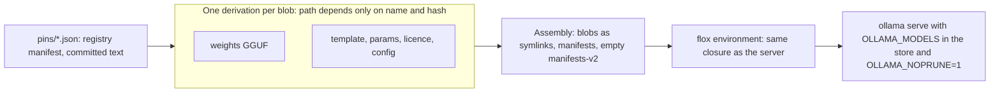

# Models in the closure

Research for the Planet Nix talk's "Models as inputs" ask, 1 Nov 2026. Nothing here is built
into the product yet: models still arrive by `ollama pull`. Binding context: ADR-0006 (intranet
only) and ADR-0008 (one flox environment). The prototype is in
[`model-closure/`](model-closure/).

## Result

This works today with no Nix or flox changes, but it is proven only on `smollm:135m` (92 MB).
gpt-oss and qwen3.5 evaluate as derivations and have not been run through it. The largest file
put through Nix was 256 MiB, so every 10–20 GB figure below is extrapolated.

## Design

One fixed-output derivation per Ollama registry blob, plus a small assembly that produces a
read-only `OLLAMA_MODELS`, installed through a flake reference in the flox manifest. An Install
gets a sealed flavour with the same store paths that cannot reach a network.

- Digests are the sha256 of each file, so every hash comes from the small manifest with no
  weight download.
- Don't use a flake `input` or `builtins.fetchurl` for weights. They buffer the file in memory
  at about 4.4× its size, roughly 60 GB for gpt-oss on a 24 GB Mac. `nix-prefetch-url` and
  `nix-store --add-fixed` stream.
- A file added with `--add-fixed` as `ollama-blob-<hex>` lands on the derivation's own store
  path, so blobs already in `~/.ollama` can be ingested without a download.
- `llama-server` also serves the same blob from the store with no workarounds. Stay on Ollama
  for now, because qwen3.5's config names a renderer and parser compiled into the server.

## Tested findings

### Ollama and a read-only store

Ollama does not accept a read-only `OLLAMA_MODELS` as it stands. It needs an empty
`manifests-v2/` in the closure, or every API call fails on `MkdirAll`, and `OLLAMA_NOPRUNE=1`,
or startup stops fatally on the prune pass. With both, chat works and `/api/copy`, `/api/create`
and `/api/delete` fail with permission errors. `$HOME/.ollama` must stay writable for the
keypair. Ollama 0.40.6, 0.40.11 and 0.40.12 all served this layout. It relies on undocumented
internals, so pin the server with the model and add a check that fails when a bump breaks it.

### flox fetches silently

With a blob deleted, `flox activate` succeeded in 24.7 s: the root daemon downloaded the weights.
On an Install with internet, that is egress ADR-0006 does not allow. A bare fixed-output
derivation whose builder only prints a message and exits has a different `.drv` and the same
output path. Activation then refused in 0.61 s, and after an import it activated to the identical
environment path. Avoid `requireFile`, which marks Apache weights as unfree.

### Same closure, same answer

Tested on one M5 Pro with 2–3 questions, 120 tokens, seed 42.

| Comparison | Result |
|---|---|
| Fresh Metal runner, repeated | Identical |
| Ollama 0.40.6, 0.40.12, direct `llama-server`, fresh Metal | Identical |
| Batch size, context size, threads, `NUM_PARALLEL`, flash attention | No change |
| Metal against CPU | Different, even at temperature 0 |
| Partial GPU offload | Different again |
| Metal, after an unrelated question on the same runner | Different, and repeatable |
| CPU, after an unrelated question | No change |

The honest claim is: same closure, same hardware class, same request history, same bytes. On
Metal, one question's answer can depend on the one before it. Prompt-cache state is a guess at
the cause, not a finding. `keep_alive: 0` avoids it at the cost of a reload per request.

### What belongs in the closure

| Setting | Where |
|---|---|
| Server version, weights, template, default params, licence | Closure, by this design |
| Context size, `OLLAMA_NO_CLOUD`, `OLLAMA_NOPRUNE`, parallelism | Closure, in the service definition; `scripts/stack.py` sets them now |
| System prompts, Watchlist, temperature, seed, effort | Closure, once the app is packaged; the last three are sent per request |
| Timezone, day end, counselor name, accounts, Catalog | Install config and state |

Pinning parameters in the model isn't enough: a client `system` message overrode the pinned
prompt, and `/v1` defaults temperature to 1.0 when unset. The assistant must keep sending them.

### Cost

| Measure | Result | Extrapolated to 13.8 GB |
|---|---|---|
| `nix hash file` | 256 MiB in 0.13 s | ~7 s |
| `nix-store --add-fixed` | 256 MiB in 0.74 s, memory flat | ~40 s |
| `builtins.fetchurl`, 184 MiB | 835 MB of memory | ~60 GB |
| `nix copy` to a file cache, 88 MB, xz (default) | 20.5 s | ~53 min for ~7% saving |
| `nix copy`, 88 MB, `compression=none` | 0.15 s | Use this |
| Download through the derivation | 3.8 MB/s | ~1 hour |

Unsigned blobs import with signature checks on, because they are content-addressed. The assembly
is refused until a key is trusted, which is one admin step on an Install. `cache.nixos.org` is
out on size (4 GiB limit). A USB stick must be exFAT or APFS.

### Routes through flox

| Route | Result |
|---|---|
| `[install]` with `flake =` | Works. Fresh checkout gave the identical environment path. **Use this** |
| `[install]` with `store-path =` | Works; handy for a demo |
| `.flox/pkgs/*.nix` with `flox build` | Works; the assembly path drifts with the catalog's nixpkgs |
| `[build]` in the manifest | Avoid: a second full copy, no hash check, `pure` can't fetch |
| `flox publish` | Not run |

## Licences

gpt-oss:20b, qwen3.5:4b and smollm:135m are all Apache-2.0. The licence layer travels in the
closure. Add OpenAI's `USAGE_POLICY`, which the Ollama layers lack. Ollama's terms don't address
redistributing its templates, which leaves a small question for a public publish. Not legal
advice.

## Gaps this exposed

- **The Python dependencies are outside the closure.** `.flox/env/manifest.toml` runs
  `uv pip install` at activation, which uses the network. Until that changes, the whole assistant
  can't be called a closure.
- **flox may reach the internet on an Install.** A default-config log shows the upgrade check
  calling `api.flox.dev`. From the source, `upgrade-notifications = false` only hides the notice.
  Not confirmed at runtime; the test only hit throttling.
- **ADR-0006 names only the Catalog as a setup exception,** yet `scripts/fetch_demo_model.sh` and
  the manifest cite it for the model. Fetching any model needs an ADR decision.
- **Signing is undecided:** the school trusts a key, or the assembly comes through FloxHub.

## What the talk can say

- **True now, on a small model:** weights can be pinned like any input with the hash taken from
  the registry manifest, a model and its server can share a read-only closure, and a missing
  model can fail closed.
- **After the first row below:** "my demo's weights are in the closure", shown with
  `nix path-info -Sh` and `nix why-depends`, and by deleting a blob, seeing the refusal,
  importing it, and getting the same environment path.
- **Still an ask:** a flox setting that an environment must never fetch or build at activation,
  a digest-pinned package type, publishing weights separately from a small signed piece, a
  stated size policy, an upgrade check that can be turned off, streaming Nix fetchers, and
  official read-only support in Ollama.
- **Avoid:** "the same closure gives the same answer" without the Metal and history qualifier.

## Next steps

| Work | Rough size |
|---|---|
| Real models in the closure on this Mac: pins, flake reference, `stack.py`, a gate check | 1–2 days |
| Install path: bundle command, signing, a clean Mac | 2–3 days |
| App and Python dependencies in the closure | 1 week or more |

## Not verified

- Nothing above 256 MiB, and no gpt-oss or qwen3.5 inference through this path. qwen3.5's
  projector layer is untested.
- A clean Mac. The test machine already had the flake source, nixpkgs and build tools.
- `flox publish`, FloxHub limits, imports as a non-trusted user, resuming a failed download, a
  real USB stick.
- Determinism across Apple chips, with gpt-oss's template (it injects the date, so the prompt
  changes daily), and across server versions with qwen3.5.

## Prior art

`josh/nixbits` and `lnbits/peasy` use the same pattern of pinned manifest and per-blob `fetchurl`.
nixpkgs' `services.ollama.loadModels` runs `ollama pull` after start, so it stays outside the
closure. agent-stacks-spec PR #7 says a stack should not download at runtime and should store
weights once per digest, which this design meets; it leaves distribution out of scope.

Building the prototype's `gpt-oss-20b` or `qwen35-4b` downloads the full weights unless the blobs
are ingested first.
